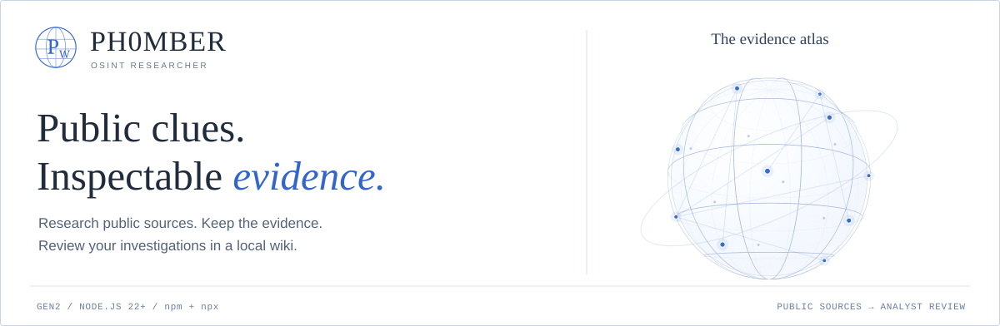

<p align="center">
  
</p>

<p align="center">
  <strong>Gen2 · v0.0.2</strong> &nbsp;·&nbsp; Node.js 22+ &nbsp;·&nbsp; MIT
</p>

<p align="center">
  <a href="https://phomber.s41r4j.in">Website</a> &nbsp;·&nbsp;
  <a href="docs/README.md">Documentation</a> &nbsp;·&nbsp;
  <a href="CHANGELOG.md">Changelog</a> &nbsp;·&nbsp;
  <a href="https://github.com/s41r4j/phomber/issues">Issues</a>
</p>

PH0MBER combines public-source collection, DeepSeek-assisted research and a local investigation wiki. Start with a name or handle, follow relevant sources, and keep a record you can inspect.

- **Research with context.** Cross-check names, profiles, institutions and projects.
- **Keep the evidence.** Review citations, source snapshots, matching explanations and revisions.
- **Work locally.** Search, organize, export and delete saved investigations from the CLI or wiki.

## Install

```sh
npm install -g phomber
phomber find
```

Or use NPX:

```sh
npx phomber find
```

`find` opens the guided research builder. AI research uses billed DeepSeek APIs and prompts privately for your key. Use `phomber find --no-ai` for source adapters only, or `--offline` for fresh cached evidence without AI.

## Research

Start with a name and add what you know:

```sh
phomber find "Full Name" --education "Known College" --depth deep
```

Or start from a profile:

```sh
phomber find --social github:known_handle
```

Add `--no-serve` to finish without starting the wiki. Run `phomber help find` for all research options.

## Everyday commands

| Command | Purpose |
| --- | --- |
| `phomber` | Open the interactive terminal |
| `phomber reports` | List saved investigations |
| `phomber search "name college"` | Search local reports |
| `phomber serve` | Start the local wiki |
| `phomber help` | Browse commands and examples |

Open the address printed by `serve`, normally **http://127.0.0.1:4317/**. Keep the terminal open while using the wiki. Optional `--open` launches your browser.

Installed, NPX and checkout commands share `~/.phomber` on macOS/Linux or `%USERPROFILE%\.phomber` on Windows. Use `PHOMBER_HOME` to choose another workspace. Data stays on that device and user account.

## Develop

```sh
npm ci --ignore-scripts
npm run setup:local
npm run local -- find
```

In another terminal, use `npm run local -- serve` to browse saved reports. This checkout is **0.0.2**. Use `phomber --version` to check your installed copy.

Run the release checks locally:

```sh
npm run release:check
```

Checks cover the website, types, regression tests and a fresh package installation. They do not publish the package or require paid AI calls. Restart the wiki after rebuilding.

## Further reading

[Command guide](docs/USAGE.md) · [AI setup and costs](docs/AI.md) · [Supported sources](docs/SOURCES.md) · [Evidence review](docs/ANALYST_WORKFLOW.md) · [Planned work](docs/TODO.md)

Matching names or handles do not establish identity. Review source attribution and uncertainty before using or sharing a report. See [responsible use](docs/RESPONSIBLE_USE.md).

Created by [s41r4j](https://github.com/s41r4j). Gen2 is [MIT licensed](LICENSE); [archived Python code](legacy/README.md) retains its original terms.
